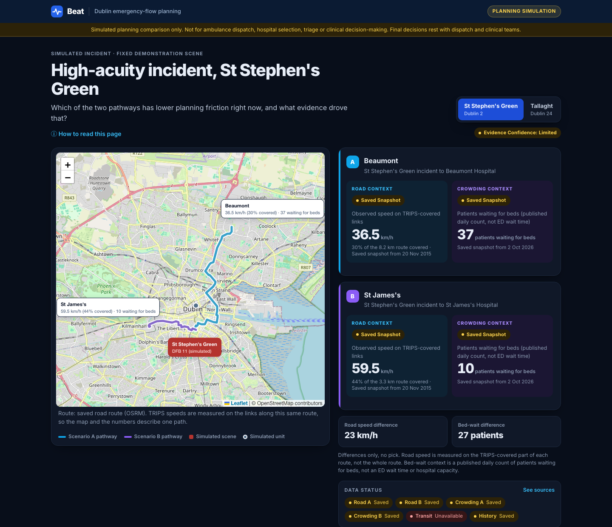
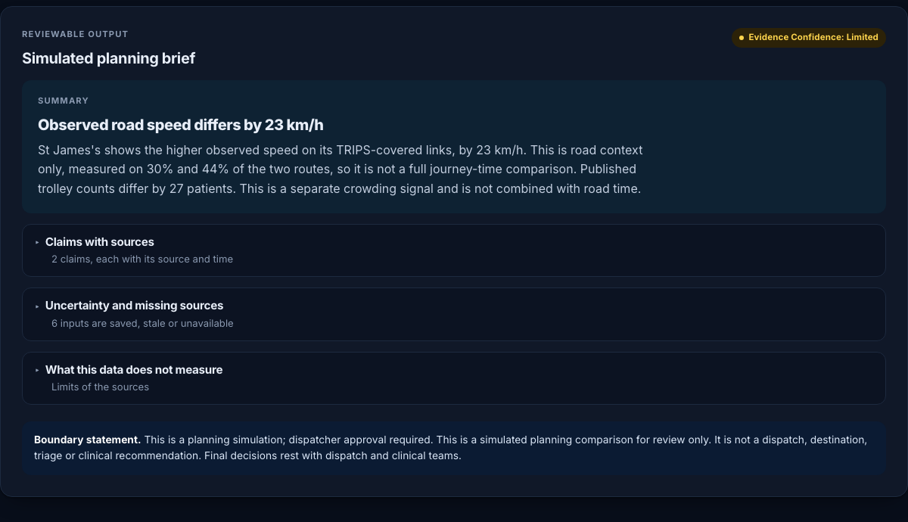

# Beat

**A Dublin emergency-flow planning simulator.** For a simulated incident, Beat compares two declared hospital pathways
using open public data and shows how road conditions and hospital crowding trade off, with the source, status and
timestamp of every figure. Built for the Build for Ireland hackathon.



It does **not** dispatch ambulances, pick a hospital, triage, or give clinical guidance. It is a planning prototype, and
final decisions stay with dispatch and clinical teams. See `AGENTS.md` for the full contract.

**Stack:** React, TypeScript, Vite, Leaflet, Vitest (191 tests). **Data:** DCC TRIPS, INMO Trolley Watch, NTA
GTFS-Realtime and Dublin Fire Brigade open data.

## Start

```bash
npm ci
npm run dev
npm test
```

The app runs on dated, replayed public-data fixtures, so the full experience works with every live feed down. Live DCC
TRIPS and NTA GTFS-R are used when reachable (see `.env.example`).

## How it works

```text
data adapters -> EvidenceEnvelope -> compareScenarios -> ComparisonResult -> planning brief -> UI + map
```

- An **incident** (St Stephen's Green or Tallaght) resolves to two candidate hospitals, which become Scenario A and B.
- **Road context** is measured on the actual route. Each pathway has a saved road route (`fixtures/pathways.json`).
  DCC TRIPS publishes the geometry of every road link (`fixtures/trips-links.json`), so Beat finds the TRIPS links that
  lie along that route, in the direction of travel, and reports the **observed speed on those links and how much of the
  route they cover**. TRIPS only covers part of the network, so this is never a full journey time. A pathway with no
  TRIPS link along it (for example Tallaght to Tallaght University Hospital) is shown as unavailable, not estimated.
- **Crowding context** is the published INMO count for that exact hospital (`fixtures/inmo-snapshot.json`).
- Road and crowding stay separate. They are never merged into one score.
- The brief cites a source and time for every claim, lists uncertainty separately, and **abstains** when the two
  pathways cannot be compared.



## Product rules

- No recommendation, no "best" pathway, no destination field. Differences only.
- INMO is a published daily count of patients waiting for beds. It is not an ED wait time or live capacity.
- TRIPS speeds are general traffic observations on covered links, not blue-light response estimates, and they reflect road
  type as well as congestion.
- Missing data is shown as `unavailable`. Nothing is invented.

## Known limits of the demo data

- The live DCC TRIPS endpoint currently returns HTTP 400, so road readings are a saved 2015 snapshot, labelled as such.
- Speeds on two pathways are measured on different road segments (30% and 44% of their routes, for example), so the
  comparison is indicative only.
- Only the St Stephen's Green scene has TRIPS coverage on both pathways. Tallaght shows how missing data is handled.
- No INMO figure is captured for Tallaght University Hospital. Add one to `fixtures/inmo-snapshot.json` to fill it.
- Unit positions are simulated.
- Regenerate the geometry fixtures with `python3 scripts/build-trips-fixtures.py <routes.csv>`. TRIPS data is from
  data.smartdublin.ie (CC BY 4.0).

## Layout

| Path | Contains |
| --- | --- |
| `src/data/` | Source registry, saved fixtures, live adapters, and the TRIPS corridor matching (`tripsCorridor.ts`) |
| `src/fleet/` | Simulated units, hospitals, incidents, and the adapter that turns an incident into Scenario A/B evidence |
| `src/domain/` | The comparison engine, shared types, safety tests |
| `src/brief/` | The planning brief, its citations and tests |
| `src/components/` | Map, pathway cards, evidence cards, brief panel |
| `src/state/` | `useComparison`, the single UI boundary |
